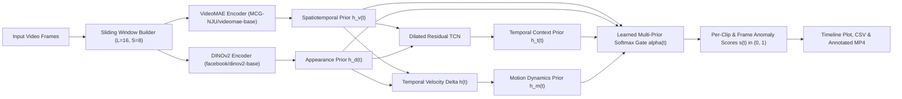

# Video Anomaly Detection Using Deep Features and Multi-Prior Fusion

[](pyproject.toml)
[](https://pytorch.org)
[](app/streamlit_app.py)
[](https://huggingface.co)
[](tests/)
[](LICENSE)

An end-to-end, reproducible PyTorch research and engineering implementation for **Video Anomaly Detection (VAD)** in surveillance videos. The system combines complementary representations from frozen self-supervised foundation models (**VideoMAE** and **DINOv2**) with a **Dilated Residual Temporal Convolutional Network (TCN)** and an inspectable **Multi-Prior Softmax Gating Fusion** module.

---

## 1. Project Motivation & Problem Definition

Detecting anomalous events in surveillance streams requires modeling both **appearance anomalies** (e.g., unauthorized vehicles on pedestrian walkways, unusual objects) and **spatiotemporal motion anomalies** (e.g., sudden running, abrupt dispersal, erratic trajectories).

Given an untrimmed surveillance video $\mathcal{V} = \{I_0, \dots, I_{N-1}\}$, this pipeline:
1. Partitions the video into overlapping fixed-length temporal windows $\mathcal{C}_t$ ($L=16$ frames, configurable stride $S$).
2. Extracts **spatiotemporal tubelet representations** $\mathbf{f}_t^{(v)} \in \mathbb{R}^{768}$ using **VideoMAE** (`MCG-NJU/videomae-base`).
3. Extracts **frame-level appearance representations** $\mathbf{f}_t^{(d)} \in \mathbb{R}^{768}$ using **DINOv2** (`facebook/dinov2-base`), aggregated across sampled frames within each window.
4. Models long-range temporal dependencies across consecutive windows via a **Dilated Residual TCN** (`TemporalConvNet`) with configurable causal or bidirectional receptive fields.
5. Fuses four complementary priors—**Spatiotemporal (VideoMAE)**, **Appearance (DINOv2)**, **Temporal Context (TCN)**, and **Temporal Feature Velocity ($\Delta \mathbf{h}_t$)**—via a learned temperature-scaled softmax gating network to output continuous clip-level and frame-level anomaly scores in $(0, 1)$.

---

## 2. System Architecture



For full mathematical equations and architectural details, see:
- [`docs/architecture.md`](docs/architecture.md) — Component-level architecture and tensor shapes.
- [`docs/methodology.md`](docs/methodology.md) — Mathematical formulation of the encoders, TCN, multi-prior gating, and supervised / weakly-supervised MIL losses.

---

## 3. Repository Structure

```text
.
├── README.md
├── pyproject.toml
├── requirements.txt
├── .gitignore
├── .env.example
├── configs/
│   ├── default.yaml               # Balanced default configuration
│   ├── cpu.yaml                   # CPU-optimized config (AMD/Intel laptops without CUDA)
│   └── gpu.yaml                   # GPU-optimized config (FP16, dense stride)
├── src/
│   └── vad/
│       ├── __init__.py
│       ├── config.py              # Dataclass schemas & YAML configuration loader
│       ├── device.py              # Hardware resolver (CPU, CUDA, DirectML, MPS)
│       ├── data/
│       │   ├── video_loader.py    # Video/frame-dir discovery, decoding, windowing
│       │   ├── preprocessing.py   # VideoMAE & DINOv2 resizing/normalization
│       │   ├── annotations.py     # JSON, CSV, UCSD .m, ShanghaiTech .npy parsers
│       │   └── dataset.py         # .npz feature caching & variable-length collation
│       ├── models/
│       │   ├── videomae_encoder.py # Frozen VideoMAE spatiotemporal wrapper
│       │   ├── dinov2_encoder.py   # Frozen DINOv2 frame-level wrapper
│       │   ├── temporal_encoder.py # Dilated Residual 1D TCN (causal & non-causal)
│       │   ├── fusion.py           # MultiPriorFusionModule with softmax gating & ablations
│       │   └── anomaly_detector.py # End-to-end trainable AnomalyDetector
│       ├── training/
│       │   ├── losses.py          # Supervised BCE, Weakly-Supervised Top-K MIL, Smoothness, Sparsity
│       │   ├── checkpoints.py     # Checkpoint save/load with reproducibility metadata
│       │   └── trainer.py         # Training loop, validation selection, early stopping
│       ├── evaluation/
│       │   ├── metrics.py         # Frame/Clip/Video ROC-AUC, PR-AUC, F1, Confusion Matrix
│       │   └── evaluator.py       # Dataset evaluation & JSON/CSV report export
│       ├── inference/
│       │   ├── predictor.py       # Sliding-window VideoAnomalyPredictor
│       │   ├── video_scoring.py   # Timestamped clip & frame DataFrames / CSV export
│       │   └── visualization.py   # Two-panel timeline plot & OpenCV MP4 overlay writer
│       └── utils/
│           ├── logging.py         # Structured console/file logger
│           └── reproducibility.py # Deterministic random seed & system metadata capture
├── scripts/
│   ├── check_environment.py       # Hardware, OS, disk space, and package audit
│   ├── download_sample_data.py    # Dataset checker & explicit synthetic data generator
│   ├── extract_features.py        # Batch VideoMAE + DINOv2 feature extraction to .npz
│   ├── train.py                   # CLI training script with ablation & MIL flags
│   ├── evaluate.py                # CLI evaluation script
│   ├── predict_video.py           # CLI single-video inference & visualization
│   └── generate_demo.py           # End-to-end synthetic smoke test pipeline
├── app/
│   └── streamlit_app.py           # Interactive Streamlit dashboard
├── tests/
│   ├── test_preprocessing.py
│   ├── test_temporal_encoder.py
│   ├── test_fusion.py
│   ├── test_metrics.py
│   └── test_pipeline.py
├── data/                          # Raw videos, cached .npz features, annotations
├── checkpoints/                   # Saved model checkpoints (.pt)
├── outputs/                       # Evaluation JSON/CSVs, timeline plots, overlay MP4s
└── docs/
    ├── architecture.md
    ├── methodology.md
    ├── dataset_setup.md
    ├── experiments.md
    └── troubleshooting.md
```

---

## 4. Installation & Hardware Setup (CPU, AMD Laptops, and NVIDIA GPUs)

### 4.1 Create Virtual Environment & Install Dependencies
```bash
python -m venv .venv
# Windows PowerShell:
.\.venv\Scripts\Activate.ps1
# Linux / macOS:
# source .venv/bin/activate

pip install -r requirements.txt
pip install -e . --no-build-isolation --no-deps
```

### 4.2 CPU & GPU Compatibility
- **AMD / Intel Laptops (No NVIDIA GPU)**: Fully supported out of the box via `configs/cpu.yaml` or `--device auto`. Optional Windows AMD GPU acceleration via `torch-directml` is automatically detected by `src/vad/device.py`.
- **NVIDIA CUDA GPUs**: Automatically detected via `--device auto` or `configs/gpu.yaml` (enables FP16 autocast for faster VideoMAE and DINOv2 extraction).

### 4.3 Verify Environment
```bash
python scripts/check_environment.py
```

---

## 5. Dataset & Pretrained Checkpoint Setup

See [`docs/dataset_setup.md`](docs/dataset_setup.md) for full details on **UCSD Pedestrian (Ped2)** (~195 MB), **ShanghaiTech Campus**, and **UCF-Crime**.

### Pretrained Encoders (Downloaded on Demand via Hugging Face)
| Encoder | Hugging Face ID | Size | Feature Dim | License |
| :--- | :--- | :---: | :---: | :--- |
| **VideoMAE** | `MCG-NJU/videomae-base` | ~345 MB | 768 | CC-BY-NC 4.0 |
| **DINOv2** | `facebook/dinov2-base` | ~346 MB | 768 | Apache-2.0 |

---

## 6. Usage & Command-Line Interface

### 6.1 Run Automated Unit & Integration Tests (Zero Large Downloads Required)
```bash
pytest -q
```

### 6.2 Run End-to-End Synthetic Smoke Test (Offline Verification)
Generates explicitly labeled synthetic surveillance videos, caches features, runs smoke training, evaluates metrics, and exports an annotated MP4 and timeline plot in `outputs/demo/`:
```bash
python scripts/generate_demo.py --config configs/cpu.yaml --epochs 8
```

### 6.3 Run the Full 5-Variant Ablation Suite
Trains all 5 architectural variants under identical seeds, splits, and configurations, benchmarks per-clip latency, saves checkpoints, copies the top checkpoint to `checkpoints/best.pt`, and exports comparison charts:
```bash
python scripts/run_ablations.py --config configs/cpu.yaml --epochs 8
```

### 6.4 Real Dataset Workflow (Extract Features -> Train -> Evaluate -> Predict)
```bash
# 1. Extract and cache aligned VideoMAE + DINOv2 clip features
python scripts/extract_features.py --config configs/default.yaml --video-dir data/raw --annotations-dir data/annotations

# 2. Train the TCN + Multi-Prior Fusion Anomaly Detector
python scripts/train.py --config configs/default.yaml

# 3. Evaluate on the test split and export JSON/CSV reports
python scripts/evaluate.py --config configs/default.yaml --checkpoint checkpoints/best.pt

# 4. Predict on a single video (exports timestamped CSVs, timeline PNG, and optional overlay MP4)
python scripts/predict_video.py --video path/to/video.mp4 --checkpoint checkpoints/best.pt --export-video
```

### 6.5 Launch the Streamlit Interactive Interface
```bash
streamlit run app/streamlit_app.py
```

---

## 7. Known Limitations & Responsible Use

1. **Pretrained Backbone Download Requirement**: Genuine feature extraction requires ~700 MB of Hugging Face weights (`MCG-NJU/videomae-base` and `facebook/dinov2-base`). Synthetic smoke-test mode (`--synthetic-encoders`) is provided strictly for software verification and is explicitly flagged in all outputs (`is_synthetic=True`).
2. **CPU Throughput**: Running dual ViT-Base foundation models on CPU is compute-intensive (several seconds per 16-frame clip). Caching features once via `scripts/extract_features.py` allows subsequent TCN/fusion training and ablation studies to complete in seconds on CPU.
3. **Ethical Disclaimer**: High anomaly scores reflect statistical deviations from training patterns and are **model predictions**, not proof of criminal activity or dangerous behavior.
