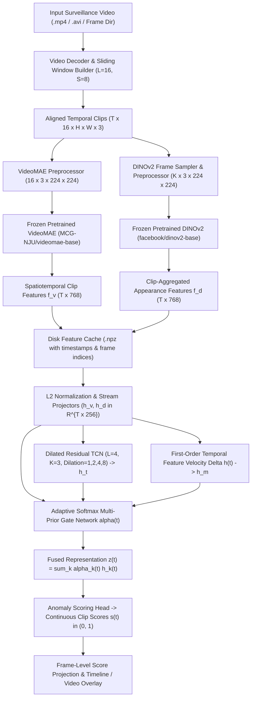

# System Architecture: Video Anomaly Detection Using Deep Features and Multi-Prior Fusion

## 1. Architectural Overview

Surveillance video anomaly detection requires recognizing both **spatial appearance anomalies** (e.g., unauthorized vehicles, unusual objects on pedestrian walkways) and **spatiotemporal motion anomalies** (e.g., sudden running, loitering, abrupt crowd dispersal). Relying on a single visual backbone creates a representational bottleneck: 2D self-supervised vision transformers excel at fine-grained object appearance but ignore inter-frame dynamics, whereas 3D masked video autoencoders capture short-range motion tubelets yet can under-represent subtle static appearance cues or long-range temporal context.

This system bridges these complementary signals through a modular four-stage pipeline:
1. **Sliding-Window Video Decoding & Preprocessing** (`src/vad/data/`)
2. **Dual Pretrained Foundation Encoders** (`src/vad/models/videomae_encoder.py`, `src/vad/models/dinov2_encoder.py`)
3. **Dilated Residual Temporal Convolutional Network (TCN)** (`src/vad/models/temporal_encoder.py`)
4. **Learned Multi-Prior Gated Feature Fusion & Scoring Head** (`src/vad/models/fusion.py`, `src/vad/models/anomaly_detector.py`)

---

## 2. Data Flow Diagram

---

## 3. Component Specifications

### 3.1 Data & Temporal Alignment (`src/vad/data/`)
- **`video_loader.py`**: Discovers standard video files (`.mp4`, `.avi`, `.mov`, `.mkv`) as well as frame-sequence directories (such as UCSD Pedestrian `Test001/*.tif`). Decodes frames into RGB `uint8` arrays while preserving exact 0-based frame indices and timestamps in seconds.
- **`build_temporal_windows`**: Slices a video into fixed-length clips of `clip_length = 16` frames with configurable `clip_stride` (default `8`). Short videos (`N < 16`) are handled explicitly via `short_video_policy="pad"` (repeating the final frame and flagging `is_padded=True`) or `"drop"`. Tail frames at the end of a video are always covered by an anchored terminal window.
- **`dataset.py`**: Stores extracted VideoMAE and DINOv2 clip features alongside window metadata and ground-truth labels in compressed `.npz` archives (`CachedVideoFeatures`). Provides `CachedFeatureDataset` and `collate_variable_length_features` to batch videos of differing durations using a boolean validity mask `mask` of shape `(B, T_max)`.

### 3.2 Spatiotemporal Encoder (`src/vad/models/videomae_encoder.py`)
- **Checkpoint**: `MCG-NJU/videomae-base` (ViT-Base architecture pretrained via Masked Autoencoding on video tubelets).
- **Input**: Tensor of shape `(B, 16, 3, 224, 224)` normalized with ImageNet mean/std.
- **Tubelet Tokenization**: Uses `tubelet_size = 2` and `patch_size = 16x16`, producing `(16/2) * (224/16) * (224/16) = 8 * 14 * 14 = 1568` spatiotemporal tokens of dimension `768`.
- **Output Representation**: Mean pooling (`pooling="mean"`) or max pooling (`pooling="max"`) across the `1568` tokens, yielding a `768`-dimensional spatiotemporal clip descriptor `f_v(t)`.

### 3.3 Frame-Level Appearance Encoder (`src/vad/models/dinov2_encoder.py`)
- **Checkpoint**: `facebook/dinov2-base` (ViT-B/14 self-supervised vision backbone).
- **Input**: Within each 16-frame window, frames are sampled every `frame_sample_rate` steps (e.g. rate `2` -> `8` frames per clip) and normalized to `(K, 3, 224, 224)`.
- **Output Representation**: Extracts the `768`-dimensional global CLS token `last_hidden_state[:, 0, :]` per sampled frame. When `pooling="cls_and_std"`, aggregates across the `K` frames via `mean(CLS) + 0.5 * std(CLS)` to capture both static appearance and intra-clip visual variation, yielding a clip-aligned `768`-dimensional vector `f_d(t)`.

### 3.4 Dilated Residual Temporal Convolutional Network (`src/vad/models/temporal_encoder.py`)
- **Structure**: Stack of `L` residual 1D convolutional blocks (`TemporalConvBlock`). Each block contains two dilated `Conv1d` layers with exponentially increasing dilation `d_l = 2^l` (`1, 2, 4, 8`), `GroupNorm`, `GELU` activations, dropout, and a `1x1` residual projection when channel dimensions change.
- **Causal vs. Non-Causal Execution**:
  - **Non-causal mode (`causal=False`, default)**: Uses symmetric padding `(K-1)*d_l / 2` so each clip aggregates bidirectional context from both preceding and succeeding clips within a buffered recording.
  - **Causal mode (`causal=True`)**: Pads strictly on the left by `(K-1)*d_l` timesteps before each convolution, guaranteeing zero temporal leakage from future frames (`t' > t`).
- **Padding Mask Isolation**: Multiplies intermediate feature maps by the boolean sequence mask `(B, 1, T)` before and after every convolution so zero-padded batch positions never contaminate valid clips.

### 3.5 Multi-Prior Feature Fusion & Scoring (`src/vad/models/fusion.py`, `src/vad/models/anomaly_detector.py`)
- Projects `f_v(t)` and `f_d(t)` into a common normalized embedding space `R^{256}` (`h_v(t)` and `h_d(t)`).
- Computes the TCN temporal context prior `h_t(t)` and an explicit first-order temporal velocity prior `h_m(t)` from `Delta h_v(t)` and `Delta h_d(t)`.
- Uses a learned temperature-scaled softmax gating network to produce inspectable per-clip prior weights `alpha(t) in [0, 1]^4` (`sum_k alpha_k(t) = 1`).
- Passes the gated representation through a two-layer MLP scoring head with sigmoid activation to output continuous per-clip anomaly probabilities `s(t) in (0, 1)`.
